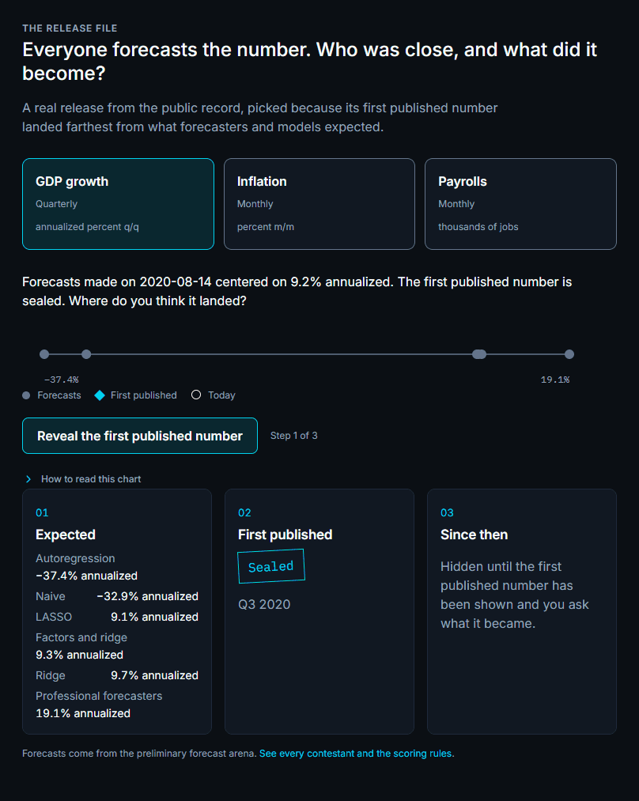

# Macro Event Lab


**Every economic number is published once, then revised. Who predicted the first version best?**

Live site: <https://aansensei.dev/macro-event-lab/>. Open the release file on the home page: the forecasts are shown first, and the real number stays sealed until you click.



| | |
| --- | --- |
| **The problem** | A US economic number such as jobs, inflation or GDP is published once and revised later. Judging a forecast against the revised number quietly uses facts nobody had at the time. |
| **What I built** | A fair test. Every forecast is replayed as of its own date, using only data published by then, and scored against the number as first published. |
| **What it shows** | How large revisions really are, and how professional forecasters and models compare. The forecast results are preliminary and labelled that way. |
| **Proof it works** | A daily automated rebuild, unit and property tests, a leakage check on every forecast, and key numbers recomputed independently. |
| **Built with** | Python, Polars, DuckDB, Parquet, React, TypeScript and GitHub Actions. |

What the public site shows:

- **Revisions:** how the first published CPI, payrolls and GDP numbers changed later.
- **GDP nowcast:** a live nowcast built only from data that was public before each release.
- **Data status:** the age of each source and the quality checks that ran.
- **Forecast arena:** professional forecasters, classical models and time series foundation models, scored point in time. Results appear after review. The rules are fixed in advance in [`pipeline/EVAL_PROTOCOL.md`](pipeline/EVAL_PROTOCOL.md).

A second, local research edition replays hour by hour prediction market odds around each release. It uses market data from Kalshi and is not published, because Kalshi's terms require written permission before anything derived from its data is made public.

How it is built: a Python pipeline (Polars, DuckDB, Parquet; raw, silver and gold layers) tested with pytest and Hypothesis, a React and TypeScript website tested with Vitest, and a daily rebuild on GitHub Actions that deploys the public edition to GitHub Pages.

## How it works

Five ideas carry the whole project.


## Repo layout

| Folder | What | Stack |
| --- | --- | --- |
| [`pipeline/`](pipeline) | Ingestion, point-in-time tables, analytics, tests | Python, Polars, DuckDB, Parquet |
| [`web/`](web) | Overview, four story pages and supporting research and reference pages | React, TypeScript, Vite, hand-drawn SVG charts |
| [`api/`](api) | MCP server for as-of-date questions (Spring 2027) | FastAPI, MCP |
| `data/` | raw / silver / gold tables, shared by pipeline and web (not committed) | |

## Why point-in-time matters

Official numbers get revised. Backtesting with today's revised values leaks information that nobody had on release day (look-ahead bias). Every row here has two clocks: what period a value describes (`observation_date`) and when the market could first know it (`realtime_start`, later an exact release timestamp).

## Architecture

```
Kalshi REST ─┐                    ┌─ silver/kalshi_markets.parquet
ALFRED API ──┼─► raw (bronze) ──► ├─ silver/kalshi_candles.parquet ──► gold ──► web JSON ──► website
             │   gzipped JSON,    └─ silver/alfred_observations.parquet
             │   content-addressed
             └── _manifest.jsonl (what, when, from where; API keys redacted)
```

- **Raw first:** every API response is saved before parsing, named by its SHA-256, so re-runs never duplicate files.
- **Rebuildable:** `build` re-parses all raw files from scratch; it is deterministic and idempotent.
- **Polite ingestion:** rate-limited client with retries on 429/5xx.

## Data sources

| Source | What | Access |
| --- | --- | --- |
| [Kalshi API](https://docs.kalshi.com) | Markets and hourly candles for CPI (`KXCPI`), payrolls (`KXPAYROLLS`), Fed rate (`KXFED`), GDP (`KXGDP`) | Public REST, no key |
| [ALFRED](https://alfred.stlouisfed.org) | Vintages of prices, employment, national accounts, spending, production, housing, credit and interest rates | Free FRED API key |
| [Survey of Professional Forecasters](https://www.philadelphiafed.org/surveys-and-data/real-time-data-research/survey-of-professional-forecasters) | Quarterly median forecasts and their official publication calendar | Approved aggregate files, non-commercial research |

Raw data stays local (not committed). Kalshi's Developer Agreement and Data Terms of Use require written permission before anything derived from its market data is published, so nothing Kalshi-derived is public yet.

SPF attribution: **Federal Reserve Bank of Philadelphia, Survey of Professional Forecasters (SPF)**.
SPF data are used for non-commercial education and research. The Philadelphia Fed name is not used
for advertising or as an endorsement. This project and its evaluations are independent and are not
sponsored, endorsed or approved by the Federal Reserve Bank of Philadelphia. Proprietary bond
series are excluded from the survey parser.

`ingest spf` saves the release calendar and the two median workbooks before parsing. A rerun resumes
from complete saved files; `--refresh` requests updated copies. Survey `known_from` uses the official
News Release Date at the end of that New York day, never the submission deadline. A missing release
date, a release before its deadline, or a release before the survey quarter uses the later of quarter
end and the deadline, also at the end of the New York day. `known_from_source` records that fallback
and its reason. Historical workbook corrections remain a limitation: a publication-calendar timestamp
does not establish that a downloaded historical value is unchanged from its original release.

SPF payroll forecasts retain quarterly employment levels in thousands of jobs. They are not monthly
job gains. Housing starts retain millions of units at an annual rate. No monthly forecast is inferred
from either quarterly level series.

## Quickstart (Windows PowerShell)

Run everything from the repo root:

```powershell
python -m venv .venv
.venv\Scripts\Activate.ps1
pip install -e ".\pipeline[dev]"
copy .env.example .env          # then paste your FRED_API_KEY into .env

python -m macro_event_lab ingest alfred
python -m macro_event_lab ingest kalshi --max-markets 20   # small test first
python -m macro_event_lab build
pytest pipeline
```

macOS / Linux: `source .venv/bin/activate` and `cp .env.example .env`.

Website (after `build`; needs Node 24):

```powershell
cd web
npm ci
npm run sync-data
npm run dev
```

## Commands

| Command | Does |
| --- | --- |
| `ingest alfred [--series ...]` | Download all vintages of the ALFRED series |
| `ingest spf [--refresh]` | Save approved median level and growth workbooks plus the official survey publication calendar |
| `ingest kalshi [--series ...] [--since YYYY-MM-DD] [--max-markets N] [--period 1/60/1440]` | Download markets and candlesticks |
| `ingest yields [--series ...]` | Download daily 2 and 10 year Treasury yields (FRED `DGS2`, `DGS10`); each close counts as known at the end of its New York day |
| `ingest french` | Download daily returns of the 12 industry portfolios and the market factor from the Kenneth R. French Data Library (kept local until permission to show them) |
| `ingest releases` | Download CPI, jobs and GDP release dates (FRED); FOMC dates come from `pipeline/src/macro_event_lab/seeds/` |
| `build` | Rebuild silver tables from raw, then gold tables (contract prices, implied distributions, stats, surprises), then the website JSON in `data/web/` |
| `check [--show N]` | Data quality checks on silver (duplicates, bid above ask, prices outside [0, 1], missing months, markets without a strike); exits 1 on errors |
| `build-public` | Rebuild the ALFRED revisions and GDP nowcast, including the live nowcast, then export source freshness and executed quality checks alongside them in `data/web_public/`; this is what the scheduled Public site workflow runs |
| `nowcast` | Evaluate the GDP nowcast walk-forward: out-of-sample errors against the naive guess, ridge coefficients with block bootstrap intervals, and the Kalshi market on the quarters it covered |
| `model` | Build local calibration training rows, MAP coefficients and temporal score comparisons of raw prices, isotonic and MAP, with Bonferroni intervals and a fixed prior sensitivity grid. See [model card](pipeline/MODEL_CARD.md). |
| `model --bayesian` | Sample a hierarchical event-weighted generalized posterior with learned pooling scales, convergence gates and limited marginal predictive checks. Requires the optional `bayes` dependencies; descriptive local results only. |
| `model --joint` | Fit one categorical outcome per event at T-1h and simulate contract labels from shared event outcomes. Requires `bayes`; includes a documented fixed support mixture and remains local and descriptive. |
| `asof 2026-10-14T12:31Z` | Print what was public at that moment: newest ALFRED vintages and open Kalshi markets |

## License

MIT
